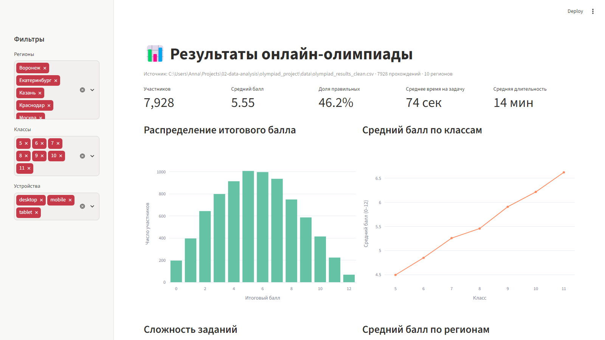

# Анализ результатов онлайн-олимпиады

Комплексный анализ прохождений онлайн-олимпиады для школьников: очистка
данных, разведочный анализ, оценка сложности заданий, региональная аналитика,
проверка статистических гипотез и интерактивный дашборд.

---

## 📌 О проекте

Крупная EdTech-компания провела онлайн-олимпиаду для школьников из **10 регионов**.
Исходная таблица содержит **8 000+ прохождений** (по 12 заданий на ученика) и
заранее «сырые» дефекты: дубликаты, опечатки в названиях регионов, пропуски
в ответах, аномальные сессии и технические ошибки.

Задача: превратить сырую таблицу в понятную аналитику: очистить данные,
найти закономерности и подготовить выводы для продуктовой и образовательной
команд.

---

## 🎬 Демо дашборда

Интерактивный дашборд построен на **Streamlit + Plotly**: фильтры по региону,
классу и устройству, KPI-карточки и живые графики с наведением/зумом.



**Запустить:** `streamlit run src/app.py` → `http://localhost:8501`

---

## 📈 Ключевые результаты

| Метрика                                                    | Значение                           |
| ----------------------------------------------------------------- | ------------------------------------------ |
| Валидных прохождений после очистки | **7 928**                            |
| Регионов                                                  | **10**                               |
| Средний балл (из 12)                                 | **5.55** (медиана 6)          |
| Общая доля правильных ответов           | **46.2%**                            |
| Среднее время на задачу                       | 73.5 сек                                |
| Средняя длительность сессии              | 14.1 мин                                |
| Рост среднего балла с классом            | 4.50 (5 кл.) → 6.62 (11 кл.)          |
| Самые лёгкие задания                            | Задание 5 (63.9%), Задание 8 |
| Самые сложные задания                          | Задание 1 (29.8%), Задание 9 |

**Выводы:**

- **Класс — самый сильный фактор** успеха: разница между 11 и 5 классом
  статистически значима (p < 0.0001, эффект Коэна d ≈ 0.78).
- **Региональные различия слабые** (Новосибирск vs Пермь, p ≈ 0.02, d ≈ 0.13).
- **Технические факторы не влияют** на балл: устройство, число попыток и
  разрывы соединения статистически незначимы (p > 0.35).
- Сложные задания (Задание 1, 9, 3) решают быстрее, но с большим числом ошибок;
  лёгкие (Задание 5, 8) — дольше и осознаннее.

---

## ✨ Возможности

- **Очистка и предобработка** — удаление дубликатов, исправление опечаток
  регионов, обработка пропусков, удаление аномальных сессий.
- **Обогащение данных** — производные метрики: длительность сессии,
  пересчитанный балл, число пропущенных заданий, среднее время на задачу,
  доля правильных ответов, час и день недели старта.
- **Анализ сложности заданий** — доля правильных среди отвечавших, среднее и
  медианное время на задание.
- **Региональная аналитика** — функция `build_region_report(region)` формирует
  сводку и график по каждому из 10 регионов.
- **Статистическая проверка** — сравнение групп (критерий Манна–Уитни + эффект
  Коэна): класс, регион, устройство, число попыток, разрывы соединения.
- **Интерактивный дашборд** — Streamlit-приложение с фильтрами по региону,
  классу и устройству, KPI-карточками и plotly-графиками.

---

## 🚀 Быстрый старт

### 1. Установка зависимостей

Требуется **Python 3.9+**.

```bash
pip install -r requirements.txt
```

### 2. Выполнить анализ (Jupyter Notebook)

Ноутбук читает сырые данные, выполняет очистку и анализ, затем создаёт
артефакты:

```bash
jupyter nbconvert --to notebook --execute notebooks/analysis.ipynb
```

На входе ноутбук использует файлы в `data/`, на выходе создаёт:

- `data/olympiad_results_clean.csv` — очищенный датасет;
- `images/` — графики;
- `reports/` — мини-отчёты по каждому региону.

Или откройте `notebooks/analysis.ipynb` в Jupyter и выполните по шагам
(`Cell → Run All`).

### 3. Запустить интерактивный дашборд

```bash
streamlit run src/app.py
```

Откройте в браузере `http://localhost:8501`. Дашборд читает очищенный
датасет `data/olympiad_results_clean.csv`, поэтому предварительно выполните
шаг 2.

---

## 📁 Структура проекта

```
olympiad_project/
├── data/
│   ├── olympiad_results.csv            # исходные «сырые» данные
│   ├── olympiad_data_dictionary.csv    # словарь данных
│   └── olympiad_results_clean.csv      # очищенный датасет (генерируется)
├── notebooks/
│   └── analysis.ipynb                  # полный цикл анализа
├── src/
│   └── app.py                          # интерактивный Streamlit-дашборд
├── presentation/
│   └── olimpiada.pptx                  # итоговая презентация
├── images/                             # графики + скриншот дашборда
├── reports/                            # мини-отчёты по регионам (генерируются)
├── requirements.txt
├── .gitignore
└── README.md
```

---

## 📊 Описание данных

| Файл                         | Описание                                                                                         |
| -------------------------------- | -------------------------------------------------------------------------------------------------------- |
| `olympiad_results.csv`         | Результаты прохождений: 8 037 строк × 46 колонок (до очистки) |
| `olympiad_data_dictionary.csv` | Словарь — описание каждой колонки                                           |

**Основные столбцы:**

- `student_id` — уникальный идентификатор ученика;
- `region`, `school_number`, `grade` — регион, школа и класс (5–11);
- `start_time`, `end_time` — время начала и конца прохождения;
- `Task_N_answer`, `Task_N_correct`, `Task_N_time_spent` — ответ, признак
  правильности и время на каждое из 12 заданий;
- `total_score` — итоговый балл;
- `device_type` — тип устройства (desktop / mobile / tablet);
- `attempts_count`, `disconnects` — технические метрики сессии.

---

## Методология:

1. **Загрузка и анализ** — размерность, типы, пропуски, дубликаты.
2. **Очистка:**
   - удаление дубликатов по `student_id` (37 записей);
   - приведение опечаток регионов к единому виду (9 вариантов → **10 регионов**);
   - обработка пропусков в `Task_*`: `correct` и `time_spent` → `0`, `answer`
     остаётся `NaN` как признак пропущенного задания;
   - удаление аномальных сессий длительностью < 60 сек (72 записи).
3. **Обогащение:** `duration_sec`, `total_score_calc`, `tasks_skipped`,
   `tasks_correct`, `avg_task_time`, `correct_rate`, `start_hour`, `start_weekday`.
4. **Анализ сложности заданий** — доля правильных **среди отвечавших**.
5. **Региональная аналитика** — `build_region_report(region)`.
6. **Статистическая проверка** — критерий Манна–Уитни и эффект-размер Коэна.
7. **Визуализация** — plotly-графики в дашборде и статистические графики
   в ноутбуке.

---

## Технологии:

[Python](https://python.org) · [pandas](https://pandas.pydata.org) ·
[NumPy](https://numpy.org) · [Matplotlib](https://matplotlib.org) ·
[Seaborn](https://seaborn.pydata.org) ·
[SciPy](https://scipy.org) · [Streamlit](https://streamlit.io) ·
[Plotly](https://plotly.com/python/) · [Jupyter](https://jupyter.org)
